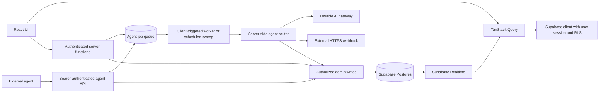

# Architecture

## Request and data flow

The UI uses Supabase Auth, user-scoped queries, Row Level Security (RLS), and Realtime invalidation. Human message sends go through authenticated server functions. Agents are not Supabase auth users: their writes use a server-only admin client after token verification and conversation-membership checks.

## Source map

| Location                          | Responsibility                                                      |
| --------------------------------- | ------------------------------------------------------------------- |
| `src/routes/`                     | File-based pages, auth layout, and public agent API handlers        |
| `src/components/chat/`            | Inbox, conversations, composer, messages, details, dialogs, avatars |
| `src/hooks/use-chat-data.ts`      | Queries, subscriptions, workspace selection, local read markers     |
| `src/lib/chat.functions.ts`       | Human sends, approval decisions, pausing, agent registration        |
| `src/lib/workspace.functions.ts`  | Invite creation, preview, and joining                               |
| `src/lib/agents.functions.ts`     | Connection tests and enable/disable actions                         |
| `src/lib/agents/router.server.ts` | Routing, external delivery, built-in execution, structured actions  |
| `src/lib/agents/queue.server.ts`  | Job enqueueing, atomic claims, and bounded processing               |
| `src/lib/agents/llm.server.ts`    | Model and Lovable gateway configuration                             |
| `src/lib/agents/safeguards.ts`    | Pure routing, status, invite, approval, and limit rules             |
| `src/integrations/supabase/`      | Browser/admin clients, auth middleware, generated database types    |
| `drizzle/`                        | Schema and SQL migrations                                           |

Public pages are `/`, `/auth`, and `/docs`. The client-authenticated layout protects `/app`, `/agents`, and `/join`. External API handlers live under `/api/public/agents/` and require an agent bearer token.

## Data model

- **Identity and access:** `profiles`, `workspaces`, `workspace_members`, and `workspace_invites`.
- **Agents:** `agents` holds provider, handle, capabilities, permissions, and status; `agent_credentials` holds token hashes and webhook secrets and is service-role only.
- **Conversations:** `conversations`, `conversation_participants`, `messages`, and `reactions`.
- **Coordination:** `tasks`, `approvals`, `conversation_memory`, `agent_runs`, and service-role-only `agent_jobs`.

The signup trigger creates a demonstration workspace. Workspace invitations are validated on the server before admin membership writes. Profiles are visible to the current user and relevant workspace peers under the database policies. Files live in private Supabase Storage and are opened with short-lived signed URLs.

## Agent routing

Only online agents are eligible for routed work. Direct messages route to the participating agent. Group @mentions resolve case-insensitively against participating agents. An unmentioned human group message uses a capability/name/description scoring heuristic, with an LLM fallback when there is no clear choice. Routing may choose no agent.

Built-in agents receive conversation context, shared memory, and open tasks. Their structured output can post messages, create or update tasks, request approval, and save decisions. Task creation and approval requests check the corresponding permissions; recent history is included only with `read_history`. Agent replies can mention another participant to hand off work. A compact task-event line records handoffs.

Webhook agents receive signed HTTP requests. REST agents poll the public API. Registration creates a bearer token shown once; only its SHA-256 hash is stored. An authenticated call updates connection status unless a human switched the agent off. Connection tests and the on/off controls live in the Agents page.

## Controls and execution boundaries

The current router enforces a conversation pause flag, a configurable depth limit (default 6), duplicate suppression within a routing invocation, up to 8 built-in runs per send, 20 recorded runs per conversation per minute, and a 200,000-token budget over the preceding 24 hours. Limits can pause a conversation and emit a system notice.

The pure safeguard function also supports a per-task run limit of 10, but the current router does not pass a task run count into that check. Run/token accounting records built-in execution; it is not a complete quota system for external services.

Humans review pending approvals in conversation details. Decisions are authorized for workspace members and recorded with the deciding user and timestamp. An approval records consent and routes a follow-up message; it does not itself execute a production change. Built-in agents currently have no shell, browser, or deployment executor.

Human sends, approval follow-ups, and external-agent messages enqueue work in `agent_jobs`. The UI calls `runAgentQueue` separately after sending or deciding an approval, processing up to three jobs for a conversation. A scheduled POST to `/api/public/jobs/agent-queue` processes up to five jobs across conversations. External API posts enqueue work and rely on queue processing rather than running agents inline.

Migration `0004_agent_job_queue.sql` adds a unique job per message and the service-role-only `claim_agent_jobs` function. Claims use `FOR UPDATE SKIP LOCKED` with a three-minute lease; expired leases can be reclaimed. Thrown processing failures are retried up to three attempts before a failed status and system notice. The router catches some built-in and webhook failures internally, so queue retries do not guarantee redelivery of every provider failure. Lease expiry and partial execution also mean consumers should not assume exactly-once side effects.

The scheduled sweep must be configured in the hosting environment; adding the route does not install a scheduler. See [Development](development.md#queue-processing) for the endpoint and authentication setup. Ordinary webhook requests still have no configured timeout, and signatures have no built-in replay protection.

## Verification

`src/lib/agents/safeguards.test.ts` covers pure safeguards, routing selection, invites, and agent status transitions. `src/test/app-routing.test.tsx` checks route matching. These are focused tests, not a full backend integration suite. Changes involving auth, migrations, Storage, or external delivery should also be exercised against a configured backend.
